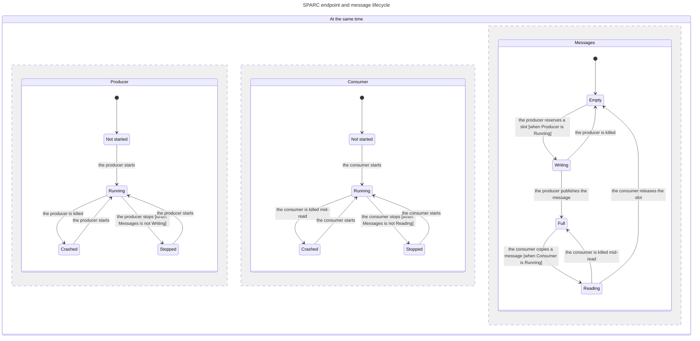

# Statechart: endpoint and message lifecycle

This page shows the state machine SPARC implements, in the words a reader of the
transport uses. A TLA+ model (`SparcLifecycle.tla` in this folder) is checked
with TLC, and the `statechart` skill draws the reachable graph as a Mermaid
statechart. The chart and report below are what the tool writes; the model,
config, and view beside this file are the source that produces them.

The model is deliberately small: one producer session, one consumer session, one
slot, and at most two published messages. It keeps the protocol decisions that
this documentation promises and leaves out the parts that do not change the
state transitions (see [What the model leaves out](#what-the-model-leaves-out)).

## The chart



Three regions move at the same time: the producer session, the consumer session,
and the message in the slot. A condition in brackets says what must hold in
another region for the step to happen.

* **Producer and consumer sessions.** Both start from `Not started`, run, and
  end in `Stopped` (graceful) or `Crashed` (hard kill). Either role can be
  claimed again from any non-running state, which is why `Crashed -> Running`
  and `Stopped -> Running` both exist.
* **Messages.** `Empty -> Writing` is `TryReserveWrite` plus the caller writing
  the payload. `Writing -> Full` is `CommitWrite`: the frame is written and
  `tail` is release-stored, so the message becomes visible. `Full -> Reading` is
  `TryPeek` (or `TryBeginRead`) by the consumer. `Reading -> Empty` is
  `AdvanceRead`, the release store of `head`.
* **Crash paths carry the guarantees.**
  `Writing -> Empty` is a producer killed before it publishes: the reservation
  is never visible and no partial message is delivered. `Reading -> Full` is a
  consumer killed mid-read: `head` has not moved, so the message is redelivered
  to the next consumer. These two arrows are the statechart form of
  [how-it-works.md §9](../how-it-works.md#9-crash-semantics).
* **Guards.** The producer stops only when it is not writing
  (`Messages is not Writing`), and the consumer stops only when it is not reading
  (`Messages is not Reading`). A crash is allowed at any point.

## Rules TLC checked

The model writes each promise in [concept.md](../concept.md#what-the-transport-guarantees)
as an invariant. TLC checked every reachable state:

| Rule | What it says | Why it matters |
|---|---|---|
| `TypeOK` | Every variable stays in its declared set. | The model is well formed. |
| `CapacityRespected` | `tail - head <= Capacity`. | The producer never overruns the consumer; the ring never overwrites an unread slot. |
| `NothingIsSkipped` | `head <= tail`. | The consumer never advances past the newest published message, so a crash redelivers instead of skipping a message: at-least-once across consumer crashes. |
| `NoUnpublishedRead` | `reading => head < tail`. | A message is only viewed after its release store, so it is never torn. |
| `ReservationNeedsSpace` | `reserving => tail - head < Capacity`. | A reservation always has a free slot behind it. |
| `NoDeadlock` | Every reachable state has a step out. | The protocol never parks both sides with no way forward. |

All six hold. There is no bug path to report.

## Report

The skill wrote this report from TLC's output:

```text
# SparcLifecycle

TLC reached 71 states and 209 steps. The chart draws 12 states and 16 arrows.
The step the producer is killed changes Producer and Messages at the same time.
The step the consumer is killed mid-read changes Consumer and Messages at the same time.

## Rules that hold
TypeOK, CapacityRespected, NothingIsSkipped, NoUnpublishedRead, ReservationNeedsSpace, NoDeadlock
```

## What the model leaves out

The chart shows the transitions, not the mechanisms around them. These are
covered by [how-it-works.md](../how-it-works.md):

* **Region handshake.** Creating versus joining a region, publishing the magic,
  validating the header, and stale-region recovery (`how-it-works.md` §2).
* **Role conflict.** The CAS from `NotPresent -> Starting -> Running`, and
  `RingBufferRoleConflictException` when a second live endpoint claims the same
  role (`how-it-works.md` §7). The model has one role variable, so it cannot show
  the rejection.
* **Capacity greater than one.** A real ring holds many messages and reuses slots
  by sequence, so `Full` is one point on a cycle rather than a single slot. The
  safety arguments are the same, and `Capacity` is a constant in the model.
* **Cached peer cursors, wait modes, notifications, and latencies.** The model
  uses `SpinThenSleep`-style independent steps with no clock, so it does not
  show how long a side waits before it refreshes a cursor or times out.
* **Chunked streaming.** Messages larger than a slot are a layer above the ring
  ([streaming.md](../streaming.md)).
* **OS transports and access control.** Windows sections, Unix files, and the
  in-memory transport are below the protocol (`how-it-works.md` §8).

## Regenerate

The skill is installed at `.opencode/skills/statechart/`. It is TypeScript, so a
runtime that executes TypeScript is required (the wrapper picks Node, Bun, or
Deno). TLC and Java are pinned to `tla2tools.jar` 1.7.4 and Temurin 25; set
`TLA2TOOLS` and `JAVA` to use an existing install instead of letting the first
run install them with `mise`.

The command needs an output folder that is new or empty. Use a scratch folder;
nothing in this repository is written by the tool.

On a POSIX shell (Git Bash, WSL, Linux, macOS):

```sh
export TLA2TOOLS=/path/to/tla2tools.jar
export JAVA=java
out=$(mktemp -d)
.opencode/skills/statechart/scripts/statechart \
  docs/statechart/SparcLifecycle.tla \
  --config docs/statechart/SparcLifecycle.cfg \
  --view docs/statechart/view.mjs \
  --out "$out"
```

On Windows PowerShell, call the TypeScript worker directly, because the POSIX
wrapper in `scripts/statechart` uses `/bin/sh`:

```powershell
$env:TLA2TOOLS = 'C:\path\to\tla2tools.jar'
$env:JAVA = 'C:\Program Files\Common Files\Oracle\Java\javapath\java.exe'
$stage = Join-Path $env:TEMP ("statechart-" + [guid]::NewGuid())
New-Item -ItemType Directory $stage | Out-Null
bun .opencode/skills/statechart/scripts/worker.ts $stage `
  docs/statechart/SparcLifecycle.tla `
  docs/statechart/SparcLifecycle.cfg `
  docs/statechart/view.mjs
Get-Content (Join-Path $stage 'done\report.md')
```

The command prints the report and writes `chart.mmd`, `report.md`, and
`tlc.out` into the output folder. It exits 0 when every rule holds and 1 when a
rule breaks; a broken rule produces the shortest path to the state that breaks
it. To refresh the chart above, replace the `mermaid` block with the new
`chart.mmd`.

## Related

* [concept.md](../concept.md) - the guarantees this chart encodes.
* [how-it-works.md](../how-it-works.md) - the full mechanism behind each state
  and arrow, including the crash table.
* [performance-invariants.md](../performance-invariants.md) - the invariants that
  keep the hot path allocation-free and cache-friendly.
